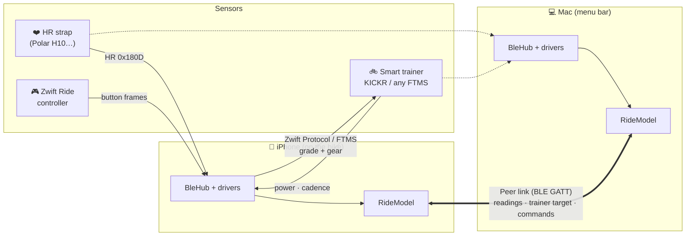
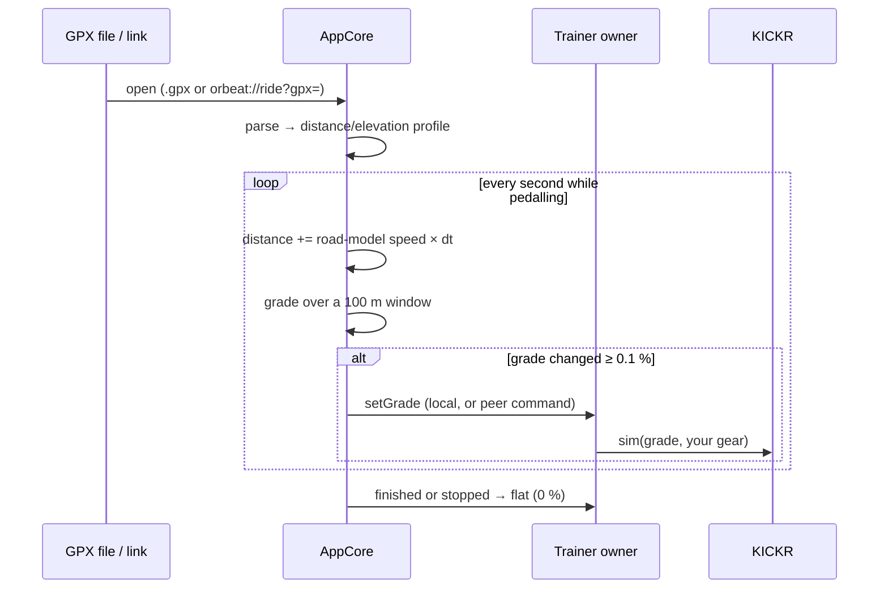

# Orbeat

**Heart rate, power and a smart trainer, on your Mac menu bar and iPhone. No Zwift subscription needed.**

Orbeat pairs directly with your Bluetooth sensors. It shows the ride live and lets your Zwift Ride paddles shift **virtual gears** on a KICKR. It can also ride the hills of any **GPX route**. The iPhone and the Mac sync over Bluetooth, so either one can be the screen, the remote or the recorder.

<table>
  <tr>
    <td align="center"><br><sub>iPhone: live ride on a GPX route</sub></td>
    <td align="center"><br><sub>Mac: menu-bar popover, mirrored from the iPhone</sub></td>
    <td align="center"><br><sub>iPhone: rider, routes, alerts</sub></td>
  </tr>
</table>

## Features

- **Live card:** BPM with a curve and min/avg/max, plus watts, cadence and road-model km/h.
- **Trainer control:** three modes, each stepped by the paddles or the menu:

  | Mode | One paddle press |
  |---|---|
  | ERG | ±5 W (30–600 W) |
  | Resistance | ±10 % |
  | Sim | ±1 gear (24 Zwift gears) |
- **Virtual gears:** on Zwift-Ready trainers (KICKR CORE Zwift One, Zwift Hub), Orbeat speaks the **Zwift Protocol**. The trainer does the gearing physics itself. On any other trainer, Orbeat falls back to FTMS sim with the gear folded into the grade.
- **Rider settings:** rider weight, bike weight and hill difficulty (Zwift's trainer difficulty). They feed both the trainer and the speed model.
- **Route mode:** open a `.gpx` from Files, the share sheet, the Mac Open panel or a `orbeat://ride?gpx=<https URL>` link. As you ride, the trainer follows the road's grade.
- **Sessions:** recorded with SwiftData and synced across devices via CloudKit. Pause, resume and stop work from either device.
- **iPhone extras:** Dynamic Island / Live Activity, a widget and heart-rate alerts that work in the background.
- **Sensor sharing:** rebroadcasts your HR and power over Bluetooth, so other apps can use them too.
- **DuckDB logging (Mac):** every BLE packet goes to a JSONL file you can query live.

## How it works



- **Either device can own a sensor.** Each side publishes only what it reads *directly* (`PeerWire`, compact JSON of 180 bytes or less per message), and the other side fills in the rest. Nothing echoes back and forth.
- **One trainer, one driver.** When only one device is connected to the trainer, that device drives it. When both are, the **iPhone drives** and the Mac mirrors its gear and grade. If the phone goes away, the Mac takes over at the last target. A Mac-side paddle press or setting is sent to the owner as a command.
- **Zwift Protocol first, FTMS fallback.** Orbeat finds the Zwift service under either UUID: the old `00000001-19CA-…` or `FC82` on newer KICKR CORE firmware. Over it, Orbeat sends `HubCommand` Simulation and Physical frames (grade, gear ratio, weights). Trainers without the Zwift service get FTMS `0x2AD9` op `0x11`.

### Route mode



Distance advances only while fresh power data is coming in, so stopping pedalling freezes you on the hill. Your gear stays yours: the route sets terrain only.

## Build

One XcodeGen project (`project.yml`) for Mac, iOS and the widget. `Orbeat.xcodeproj` is generated, not committed. Signing needs your Apple ID in Xcode → Settings → Accounts; the iCloud entitlements need provisioning profiles.

```sh
./build.sh              # Mac → ./Orbeat.app
ios/deploy.sh [name]    # build + install + launch on a paired iPhone (USB or Wi-Fi)
./test.sh               # decoder / driver / wire / route tests
```

**Pairing:** on the Mac, right-click the menu-bar icon → **Connect Equipment**. On the iPhone: Settings → **Equipment**. The Zwift Ride controller shows as `— Controller`.

## Sync

- **Live:** the Mac hosts a custom GATT service (`PeerLink.swift`) and the iPhone connects to it as a central, which survives backgrounding. Trainer steps, mode changes and session stop/pause go to whichever device owns the trainer or the session.
- **History:** SwiftData in `Application Support/Orbeat/sessions.store`, synced via CloudKit (`iCloud.com.vibecode.orbeat`).
- **Settings:** the alert threshold syncs through the iCloud key-value store. Rider settings come from whichever device owns the trainer.

## DuckDB logging

Right-click the menu-bar icon → **Log to DuckDB (JSONL)**. While logging is on, every BLE packet is appended to `~/Library/Application Support/Orbeat/orbeat.jsonl`, one row per packet:

- `src: "hr"`: bpm, plus rr_ms, contact and kj when the strap sends them.
- `src: "pwr"`: watts, rpm, kmh and the raw wheel/crank counters, plus torque and balance when sent.

```sh
brew install duckdb
duckdb -c "SELECT * FROM read_json_auto('$HOME/Library/Application Support/Orbeat/orbeat.jsonl')"
```

Every query re-reads the file, so results always include the latest samples.

## Credits

The Zwift Ride and Zwift Hub protocols are plaintext and need no crypto. They were reverse-engineered from [qdomyos-zwift](https://github.com/cagnulein/qdomyos-zwift).
