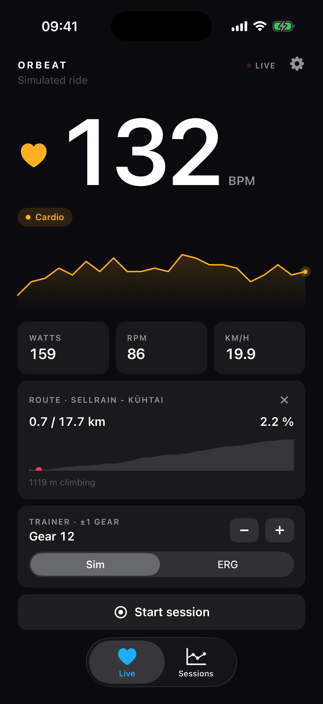
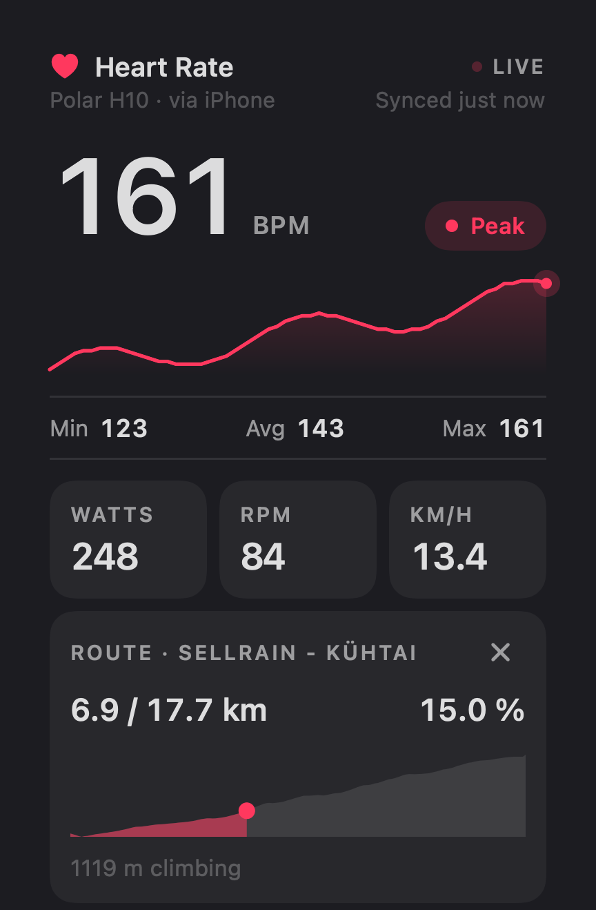
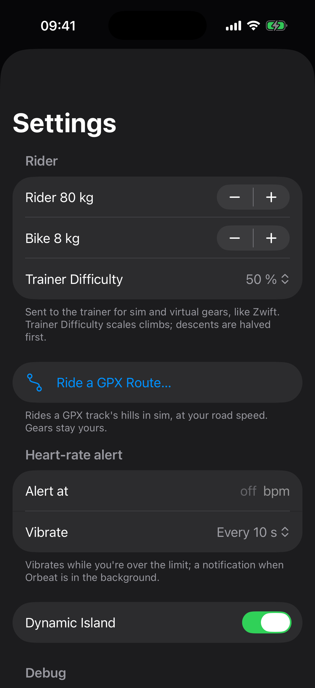
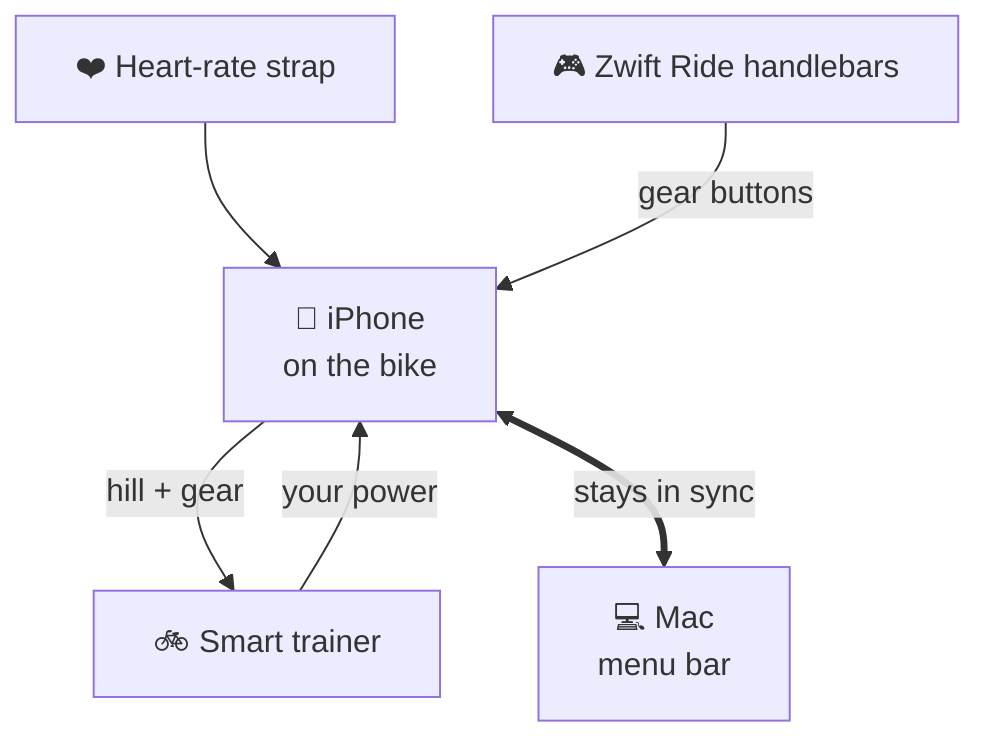
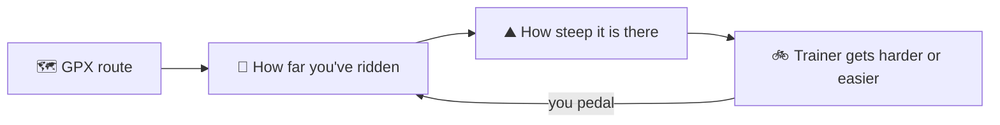

# Orbeat

**Ride your smart trainer from your iPhone and Mac. No Zwift subscription needed.**

Orbeat connects to your heart-rate strap, your smart trainer and your Zwift Ride handlebars. It shows your ride live, lets the handlebar buttons change gears, and can make the trainer feel like a real climb from any GPX route.

<table>
  <tr>
    <td align="center"><br><sub>Riding a route on the iPhone</sub></td>
    <td align="center"><br><sub>Same ride in the Mac menu bar</sub></td>
    <td align="center"><br><sub>Your weight, routes and alerts</sub></td>
  </tr>
</table>

## What it does

- 🫀 **See your ride live:** heart rate, power, cadence and speed, on the iPhone, in the Mac menu bar, and on the iPhone's Lock Screen (Dynamic Island).
- ⚙️ **Shift gears with your handlebars:** the Zwift Ride buttons change virtual gears, just like in Zwift.
- ⛰️ **Ride real roads:** open a GPX file and the trainer gets harder on the climbs and easier on the descents as you ride along.
- 🏋️ **Three ways to train:** a *hill* mode with gears, a fixed *power target*, or a fixed *resistance*.
- 📱💻 **iPhone and Mac work together:** connect sensors to either one and both show everything. Either one can shift gears, and the Mac shows the gear you're in.
- 📊 **Your rides are saved** and synced through iCloud.
- 🔔 **Heart-rate alert:** your phone buzzes when you go over your limit.

## How it fits together



The iPhone is the one on the bike: it talks to your sensors and sets the trainer. The Mac shows the same ride and can control it too. If the iPhone isn't around, the Mac connects to the sensors itself.

### Riding a route



Your speed comes from your power and weight, like on a real road. Stop pedalling and you stay put on the hill. The route only sets the hill: your gear is still up to you.

To start a route, open a `.gpx` file in Orbeat (from Files, AirDrop or a link) or choose **Ride a GPX Route…** in Settings.

## Getting started

1. Build and install (see below).
2. Pair your equipment: on the iPhone go to **Settings → Equipment**; on the Mac, right-click the menu-bar icon → **Connect Equipment**.
3. Set your weight in Settings, and start pedalling.

Tested on a Wahoo KICKR CORE Zwift One. Other smart trainers that support the standard FTMS protocol should work too.

## For developers

```sh
./build.sh              # Mac app → ./Orbeat.app
ios/deploy.sh [name]    # build, install and launch on your iPhone
./test.sh               # run the tests
```

The project is generated with XcodeGen from `project.yml`. To build, sign in with your Apple ID in Xcode → Settings → Accounts.

<details>
<summary>Technical notes</summary>

- **Trainer control:** Orbeat uses the Zwift Protocol on trainers that offer it. It finds the service under either `00000001-19CA-…` or `FC82` (newer KICKR CORE firmware). Every other trainer gets FTMS simulation (`0x2AD9` op `0x11`).
- **iPhone ↔ Mac link:** a custom Bluetooth service (`PeerLink.swift`). Each side sends only what it reads directly, as compact JSON of 180 bytes or less per message. When both are on the trainer, the iPhone drives it and the Mac mirrors.
- **Route grade:** measured over 100 m, sent when it changes by 0.1 % or more, at most once a second.
- **History:** SwiftData synced through CloudKit.
- **Packet log (Mac):** right-click → **Log to DuckDB (JSONL)** writes every Bluetooth packet to `~/Library/Application Support/Orbeat/orbeat.jsonl`:
  ```sh
  duckdb -c "SELECT * FROM read_json_auto('$HOME/Library/Application Support/Orbeat/orbeat.jsonl')"
  ```
- **Credits:** the Zwift Ride and Zwift Hub protocols come from [qdomyos-zwift](https://github.com/cagnulein/qdomyos-zwift).

</details>
